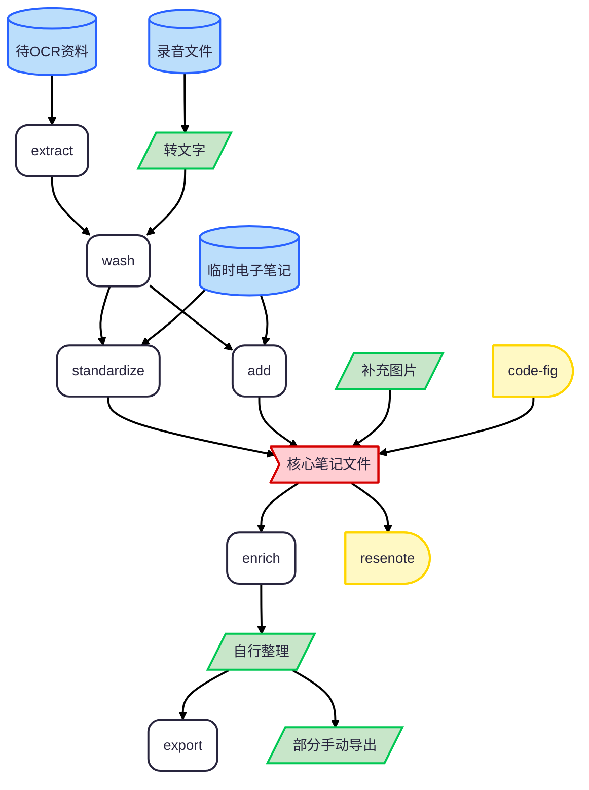

<h1 align="center">Ordinote: General Note Organizer</h1>

<p align="center">
  
  
</p>

通用笔记整理技能，处理 OCR 识别笔记、课堂笔记、读书笔记等各类 markdown 笔记的整理、合并、补充与归档。

## 功能

| # | 功能      | 说明                                                                | 定义文件                                  |
| - | ------- | ----------------------------------------------------------------- | ------------------------------------- |
| 1 | PDF/PPT/Word/图片提取 | 调用脚本提取 PDF/PPT/DOC/图片文字为提取稿（本地或 MinerU API）；Word（.docx）本地转换为保留格式的 markdown；只负责提取，整理交由 `ordinote-wash`；提取失败如实告知，不编造 | `references/ordinote-extract.md`        |
| 2 | 噪音清理     | 清理原始文字稿（OCR 识别 / 录音转文字 / Word 提取稿）：修错别字、修口音、公式转 LaTeX、去除提取噪音；在原文件上修改另存为 `笔记去噪-{YYMMDD}.md`；不添加不删改内容             | `references/ordinote-wash.md`         |
| 3 | 规范化整理   | 将笔记重组为结构清晰的标准化笔记（`{原文件名}-标准化.md`）：有以往整理笔记则参考其格式，否则按笔记逻辑自行组织；仅调序不改内容，疑点用 `<mark>` 标注 | `references/ordinote-standardize.md`    |
| 4 | 添加内容    | 将新笔记（子笔记）按内容归入已有的整理笔记（母笔记），格式向母笔记看齐；分无损add（全部归入，母/子内容零删改）与去重add（先比对母笔记已有内容、剔除重复部分，生成合并计划经用户确认后再加入）两种模式，未指定模式时先询问用户 | `references/ordinote-add.md`          |
| 5 | 补充完善    | 识别笔记中缩写、略写、乱码公式等略写部分，联网搜索补全；新增内容用淡粉色 `<mark>` 高亮，原公式旁追加 LaTeX 转写  | `references/ordinote-enrich.md`       |
| 6 | 导出 PDF / Word | 把单个笔记或整个目录批量导出为 PDF 或 Word：PDF 版式复用本机 MPE 扩展自带的样式与 mermaid 资源，观感与 MPE 预览一致；Word 由 python-docx 生成，忠实还原标题等级、文字高亮与背景色、图片、表格、列表等；源笔记只读 | `references/ordinote-export.md`       |

## 脚本

| 脚本                         | 说明                                                                                                                                                                                                                                              |
| -------------------------- | ------------------------------------------------------------------------------------------------------------------------------------------------------------------------------------------------------------------------------------------------- |
| `scripts/extract_pdf_pptx.py` | 本地提取 PDF/PPTX 全部文字，生成 `{原文件名}-提取.md`；分页/分幻灯片以 `---` 分隔，保留 PPT 演讲者备注；扫描版 PDF 提取失败时退出码 2                                                                                          |
| `scripts/extract_docx.py`   | 本地提取 Word（.docx）为 markdown，保留标题层级、列表、行内格式、表格与内嵌图片；楷体批注转淡灰色 mark，霞鹜文楷正文不误伤；支持目录批量、去文件名版本号、指定输出目录与后缀；旧版 .doc 不支持，退出码 1 并提示另存为 .docx |
| `scripts/mineru_api.py`    | MinerU 精准解析 API（云端备选），适用于扫描件、复杂版式；支持 PDF/PPT/DOC 及图片（png/jpg/jpeg/jp2/webp/gif/bmp）OCR，支持多文件批量（每批 ≤ 50 个）与指定页码解析；默认只输出 Markdown，显式加 `--save-json` 时才额外保存 `content_list.json` 与 `layout.json`，不导出图片；Token 通过 PowerShell 配置到环境变量 `MINERU_API_TOKEN` |
| `scripts/md2pdf.py`        | 批量把 markdown 笔记导出为 PDF，版式与 MPE 预览一致：无头 Chrome 打印，样式与 mermaid 取自本机 MPE 扩展，公式用 KaTeX 渲染并内嵌字体；需要本机已装 MPE 扩展与 Chrome/Edge，不下载依赖，源笔记只读 |
| `scripts/md2docx.py`       | 批量把 markdown 笔记导出为 Word（.docx）：python-docx 原生构建，还原 Heading 1-6 标题样式、加粗/斜体/删除线/下划线、`<mark>` 与 span 的任意背景色文字底纹、行内代码与代码块、引用、嵌套列表、表格、超链接与图片（本地/远程/data URI，按版心缩放）；公式转成 Word 原生公式对象（OMML），转换失败时退回 LaTeX 原文；基础依赖 `python-docx`、`markdown-it-py`，公式的附加依赖见“导出 Word”；源笔记只读 |

## 使用

### 安装

- 将 `ordinote-organizer.zip` 上传到 Agent 客户端的技能上传/安装界面
- 直接将 `ordinote-organizer.zip` 发送给模型，让其帮忙在客户端安装

### 在对话中激活

对模型说"整理笔记"、"补充完善这篇笔记"、"把这个 PPT 整理成文档"等即可触发对应功能；技能入口与各功能的详细规范见 `SKILL.md` 与 `references/`

MinerU 提取默认只输出 markdown。需要保留版式 JSON 时，必须在对话中明确说明（如"保留版式信息""同时保留 JSON"），否则不会生成。

文件夹结构与文件归类的整理已独立为 `TexturaNexus` 技能（`textura-nexus`），此类请求在其下处理。

### 配置 MinerU API

云端提取（`scripts/mineru_api.py`）需配置 Token；本地提取（`extract_pdf_pptx.py`）无需配置。

1. 在 [MinerU API 管理页](https://mineru.net/apiManage/docs) 创建 Token
2. 用 PowerShell 永久写入环境变量（一台电脑配置一次即可）：

    ```powershell
    [Environment]::SetEnvironmentVariable("MINERU_API_TOKEN", "你的token", "User")
    ```

3. 重开终端后生效；重启终端后，使用以下命令检查是否完成配置：

    ```powershell
    $env:MINERU_API_TOKEN
    ```

### 导出 PDF（需自行安装 MPE 扩展）

PDF 导出复用本机 Markdown Preview Enhanced（MPE）扩展自带的主题样式与 mermaid 渲染库，使用前需要准备：

1. **在本地的类 VS Code 客户端中自行安装 [Markdown Preview Enhanced](https://marketplace.visualstudio.com/items?itemName=shd101wyy.markdown-preview-enhanced) 扩展**（Trae / VS Code / Cursor 等任一即可）。脚本会自动搜索该扩展的安装目录并复用其中的样式与图表资源；未安装时脚本直接报错，并提示安装扩展或手动指定路径。
2. 本机需装有 Chrome / Edge / Chromium 之一，用于无头打印。

使用方式：

```bash
python scripts/md2pdf.py <文件或目录> [--out 输出目录] [--theme github-light] [--paper A4]
```

输出默认放在源文件同目录、与源文件同名；完整选项与降级行为见 `references/ordinote-export.md`。

已知差异：公式与 mermaid 图正常渲染；代码块无语法高亮；`tikz` 代码块不渲染（MPE 的 tikz 引擎在扩展内部，外部脚本无法调用），在 PDF 中以代码文本呈现。

### 导出 Word

Word 导出不依赖 MPE 扩展，基础依赖为两个 Python 库（缺失时脚本会提示安装）：

```bash
pip install python-docx markdown-it-py
```

公式转换需要 `latex2mathml`（首次运行时脚本自动安装）和本机 Office 的 `MML2OMML.XSL`（自动查找，可用 `--omml-xsl` 指定）；缺少任一条件时公式退回 LaTeX 原文。

使用方式：

```bash
python scripts/md2docx.py <文件或目录> [--out 输出目录] [--skip-existing] [--exclude 正则] [--omml-xsl 路径]
```

输出默认放在源文件同目录、与源文件同名的 .docx。还原效果：

- 标题 `#` ~ `######` 对应 Word 内置 Heading 1-6 样式，可直接生成导航目录
- `<mark>` 与 `<span style="background-color:...">` 按原色还原为文字底纹（淡粉、淡灰、黄色等均可），同时支持 span 字体颜色
- 图片内嵌插入（相对路径、远程 URL、data URI）；尊重 markdown 中 `` / `style="width:..."` 指定的尺寸（px/%/cm 等单位），未指定时按原生大小、超版心自动等比缩放；实际插入宽度取该尺寸的 85%
- 加粗 / 斜体 / 删除线 / 下划线、行内代码与代码块、引用、嵌套有序无序列表、表格、超链接均按 Word 原生格式构建
- 正文 8.5 号字、1.1 倍行距、段后 3pt，代码 8 号字；标题字号 13 ~ 9.5；页边距左右 1.8cm、上下 1cm；表格文字与正文同号
- 公式转成 Word 原生公式对象（OMML），多行 `aligned` 环境按行拆分；无法转换时以 Cambria Math 保留 LaTeX 原文并在汇总中计数
- mermaid 与 `tikz` 代码块保留为代码文本；缺失图片以红色提示文字占位并在汇总中计数

完整说明见 `references/ordinote-export.md`。

### 笔记工作流

- 圆柱：输入资料
- 平行四边形：人工处理
- 圆角矩形：LLM + skill 处理
- 长 D 形：其他 skill



